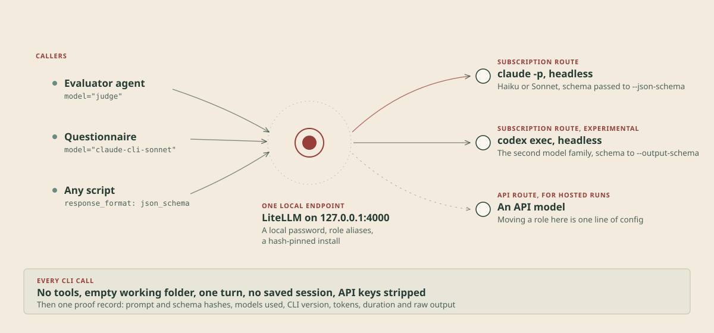

# headless-llm-gateway

A personal LiteLLM gateway. Agents and scripts call one OpenAI-compatible endpoint on localhost with a model alias such as `judge`, and `config.yaml` decides where the call goes: an API model, or a headless CLI session (`claude -p`, `codex exec`) on the owner's own subscriptions.

Write-up: [A local gateway for headless Claude and Codex](https://www.markuswalker.com/projects/llm-gateway/). It carries every model call in my [Offerings Atlas](https://www.markuswalker.com/projects/offerings-atlas/).

See the [decision log](docs/decision-log.md) and [learning journal](docs/learning-journal.md) for why it is built this way.

Subscription CLI routes are bound to 127.0.0.1 and used only by the owner. Hosted or enterprise deployments use API keys only.



## Endpoint and aliases

Endpoint: `http://127.0.0.1:4000/v1` (OpenAI-compatible). Auth: `Authorization: Bearer <LITELLM_MASTER_KEY>`.

| Alias | Route | Billing | Typical latency |
| --- | --- | --- | --- |
| `judge` | role alias, currently `claude-cli-haiku` | Claude subscription | 5 to 8 s |
| `claude-cli-haiku` | `claude -p --model claude-haiku-5-5` | Claude subscription | 5 to 8 s |
| `claude-cli-sonnet` | `claude -p --model claude-sonnet-5-5` | Claude subscription | 4 to 6 s |
| `codex-cli-sol` | `codex exec -m gpt-6.1-sol`, reasoning effort low | ChatGPT login | about 11 s |
| `anthropic-haiku` | Anthropic API, `claude-haiku-5-5` | Console credit (USD 0.10 / 0.50 per million tokens) | API speed |

To move a role to another route, change one line under `router_settings.model_group_alias` in `config.yaml` and restart.

## Calling it from an agent

```python
import json, os
from openai import OpenAI

client = OpenAI(base_url="http://127.0.0.1:4000/v1", api_key=os.environ["LITELLM_MASTER_KEY"])
raw = client.chat.completions.with_raw_response.create(
    model="judge",
    messages=[{"role": "system", "content": "..."}, {"role": "user", "content": "..."}],
    response_format={"type": "json_schema", "json_schema": {"name": "evidence_check", "schema": SCHEMA, "strict": True}},
)
result = json.loads(raw.parse().choices[0].message.content)
call_id = raw.headers["x-litellm-call-id"]  # joins to litellm_call_id in logs/proof-*.jsonl
```

Rules for callers:

- Send `stream=false`. CLI routes do not stream.
- Use `response_format` with a JSON schema for anything a program reads. The claude-cli route passes it to `--json-schema` and returns `structured_output`. The codex-cli route passes it to `--output-schema`, which needs `additionalProperties: false` and every property listed in `required`.
- Text only. Images and other content parts are rejected on CLI routes.
- Set a client timeout of at least 120 s. CLI calls queue behind `GATEWAY_CLI_CONCURRENCY` (default 2).
- System messages become `--system-prompt` for Claude and an `Instructions:` block for Codex. Multi-turn histories are written out as one labelled transcript.

## Proof capture

Every CLI call appends one JSON line to `logs/proof-YYYY-MM-DD.jsonl` (not committed): LiteLLM call ID, SHA-256 of system prompt, prompt and schema, requested model and models actually used, CLI version, auth method, session or thread ID, duration, usage, the CLI's notional cost, `is_error` and `subtype`, and the raw stdout.

## Run it

```powershell
.\scripts\start.ps1          # binds 127.0.0.1:4000, refuses to start without a master key
python scripts\smoke_test.py judge claude-cli-sonnet codex-cli-sol anthropic-haiku
```

The start script also sets `PYTHONPATH` so `config.yaml` can load `gateway/`, and `LITELLM_LOCAL_MODEL_COST_MAP=True` so LiteLLM uses its pinned price map, with no download at start-up.

## Set up on a machine

```powershell
gh repo clone Markus-Doc/headless-llm-gateway
cd headless-llm-gateway
py -3.12 -m venv .venv
.\.venv\Scripts\Activate.ps1
python -m pip install --require-hashes -r requirements.txt
Copy-Item .env.example .env   # then fill in the values
```

Each machine needs its own `claude` and `codex` logins. Check with `claude auth status` (expect `"authMethod": "claude.ai"`) and `codex login status`.

### Optional: isolate Codex from your global AGENTS.md

`codex exec` loads `$CODEX_HOME/AGENTS.md` and your skills list on every call, even with `--ignore-user-config` (about 15k extra input tokens). To stop that, give the gateway its own Codex home and log in there once:

```powershell
$env:CODEX_HOME = "$env:USERPROFILE\.codex-gateway"
codex login
Remove-Item Env:CODEX_HOME
```

Then set `GATEWAY_CODEX_HOME` to that folder in `.env`. Proof records show `codex_home_isolated: true` once it is in use.

## Upgrading LiteLLM

Take the newest stable release that is at least 7 days old, after checking the [security advisories](https://github.com/BerriAI/litellm/security/advisories). Edit the pin in `requirements.in`, regenerate the lock, reinstall, run the smoke test and record the change in the decision log:

```powershell
pip-compile --generate-hashes --allow-unsafe --strip-extras -o requirements.txt requirements.in
python -m pip install --require-hashes -r requirements.txt
```

## Known quirks

- A request without a key is refused, but LiteLLM 1.104.0 answers 500, not 401, because its error handler tries to import the database client `prisma`, which this setup does not install. A wrong key gets 400.
- LiteLLM 1.104.0's price map has no Claude 5.5 entries. Prices for `anthropic-haiku` are set in `config.yaml`.
- The CLIs are called directly (`claude.exe`, `node codex.js`), not through the npm `.cmd` shims, because cmd.exe re-parses arguments such as `--tools ""`.

## Status

1. Concepts. Done.
2. Repo and environment. Done.
3. LiteLLM 1.104.0, hash-pinned. Done.
4. API route `anthropic-haiku`. Configured, waiting for the API key in `.env`.
5. `claude-cli` route. Done and tested.
6. `codex-cli` route. Done and tested. OpenAI's terms question is open (decision log).
7. Proof capture. Done (local JSONL). Budgets and a spend database are not set up.
8. Optional: Ollama on the RTX 3070 machine. Not started.

## Licence

MIT, see [LICENSE](LICENSE). Third-party notes are in [NOTICE](NOTICE). Security reports: [SECURITY.md](SECURITY.md).
